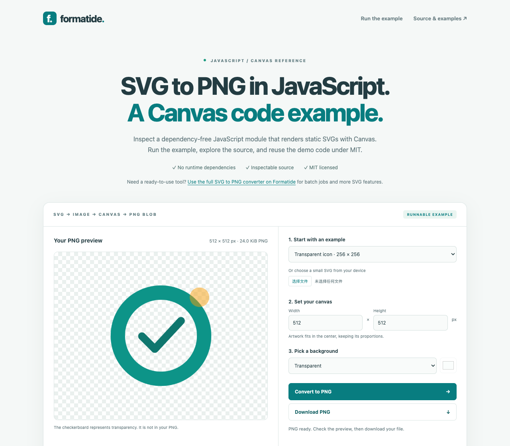

# Formatide — SVG to PNG JavaScript & Canvas Example

Learn the SVG-to-PNG Canvas workflow with a small, dependency-free JavaScript reference implementation. This repository is the public companion to [Formatide's browser conversion tools](https://formatide.com/converter).

**[Run the SVG to PNG JavaScript example](https://mcflysj.github.io/formatide-svg-to-png/)** · **[Convert SVG to PNG in your browser](https://formatide.com/)** · [Demo module & API](demo/README.md) · [Conversion guide](docs/svg-to-png-guide.md)

## A demo you can use and reuse

The [GitHub Pages demo](https://mcflysj.github.io/formatide-svg-to-png/) creates real PNG downloads on your device. Choose a bundled SVG, load a small file, or edit the source. Set a fixed canvas, keep a transparent background or add a solid color, then inspect and download the result.

[](https://mcflysj.github.io/formatide-svg-to-png/)

- **Standalone module:** [`demo/svg-to-png.js`](demo/svg-to-png.js), with no runtime dependencies.
- **Reusable code:** the files in [`demo/`](demo/) are [MIT licensed](demo/LICENSE).
- **Working examples:** a transparent icon, a wide banner and viewBox-only artwork.
- **Browser checks:** PNG dimensions and pixels, local processing, unsupported content, download invalidation and mobile layout are tested in Chromium and WebKit.

This is an independent reference implementation with a deliberately small SVG subset. The full Formatide application's source code is not included.

| | Public demo | Full SVG to PNG tool |
| --- | --- | --- |
| Input | One static SVG, up to 64 KiB | Up to 50 SVGs; 10 MiB each, 50 MiB per batch |
| Size | Fixed canvas, up to 2,048 px per side | Original, 1×–4×, proportional resize or fixed canvas; up to 4,096 px per side and 16 MP |
| SVG features | Shapes, internal gradients, simple shape references, flat clipping and masks | Broader static SVG support, including supported embedded resources and text |
| Downloads | Individual PNG | Individual PNGs, batch ZIP and saved-part continuation at the 64 MiB results budget |
| File processing | On your device | On your device |

For larger files or batch ZIP downloads, use the [full SVG to PNG converter](https://formatide.com/).

## Try three useful exports

1. **Transparent icon:** load the icon sample and export at 512 × 512. Its empty corners remain transparent.
2. **Square canvas:** load the wide banner and set 512 × 512. The artwork stays centered without stretching or cropping.
3. **ViewBox dimensions:** load the viewBox artwork. Its original dimensions are 640 × 360 even without width or height attributes.

The [sample folder](examples/) contains the original SVGs. The [conversion guide](docs/svg-to-png-guide.md) explains sizing, fonts, transparency and common export problems.

## Reuse the renderer

Serve the files over HTTP, then import the browser module:

```js
import { svgToPng } from './demo/svg-to-png.js'

const png = await svgToPng(svgSource, {
  width: 512,
  height: 512,
  background: 'transparent', // or a six-digit hex color
})
// png is a real image/png Blob; preview or download it with an object URL.
```

See the [API and supported SVG subset](demo/README.md) before using it with your own files. This demo rejects text, styles, filters, embedded images, scripts and external resources rather than attempting to render every SVG feature.

## Current tools on Formatide

Checked against the live website on **October 30, 2026**. The website now offers 13 converters; the Pages demo above focuses on SVG to PNG.

| Task | Live tools |
| --- | --- |
| SVG exports | [SVG to PNG](https://formatide.com/), [SVG to JPG](https://formatide.com/svg-to-jpg), [SVG to WebP](https://formatide.com/svg-to-webp), [SVG to ICO](https://formatide.com/svg-to-ico) |
| Images to JPG | [JFIF to JPG](https://formatide.com/jfif-to-jpg), [AVIF to JPG](https://formatide.com/avif-to-jpg), [WebP to JPG](https://formatide.com/webp-to-jpg), [PNG to JPG](https://formatide.com/png-to-jpg), [HEIC to JPG](https://formatide.com/heic-to-jpg) |
| Photos to PDF | [JPG to PDF](https://formatide.com/jpg-to-pdf), [HEIC to PDF](https://formatide.com/heic-to-pdf) |
| Structured data | [CSV to JSON](https://formatide.com/csv-to-json), [JSON to CSV](https://formatide.com/json-to-csv) |

The photo-to-PDF tools offer previews, ordering, 1/2/4 photos per page and A4 / Letter / Match image layouts. HEIC support targets supported primary still photos. The data tools handle UTF-8 CSV and flat JSON object arrays, with delimiter options and controls for IDs, columns and formula protection. Read each tool's page for its own limits and supported inputs.

## Run locally

Use Node.js 24 or newer:

```sh
npm ci
npm run build
python3 -m http.server 8080 --directory _site --bind 127.0.0.1
```

Open `http://127.0.0.1:8080/`. The build copies only the demo, samples and demo license into `_site/`; it needs no API keys or conversion server.

```sh
npx playwright install chromium webkit
npm test
```

Pushes to `main` run the browser checks and publish GitHub Pages after they pass. Pull requests run checks without deploying. See [CONTRIBUTING.md](CONTRIBUTING.md) for small, useful ways to improve the example.

## Privacy and feedback

The Pages demo has no analytics or conversion API. GitHub serves the page and its sample files; your selected SVG and PNG stay in your browser. The full website has its own [privacy policy](https://formatide.com/privacy), including optional analytics that requires consent.

[Report a conversion problem or suggest an improvement](https://github.com/mcflysj/formatide-svg-to-png/issues/new/choose). Use a synthetic SVG and remove private artwork or identifying details from public issues and screenshots.

[Browse all Formatide converters](https://formatide.com/converter) · [About Formatide](https://formatide.com/about)
