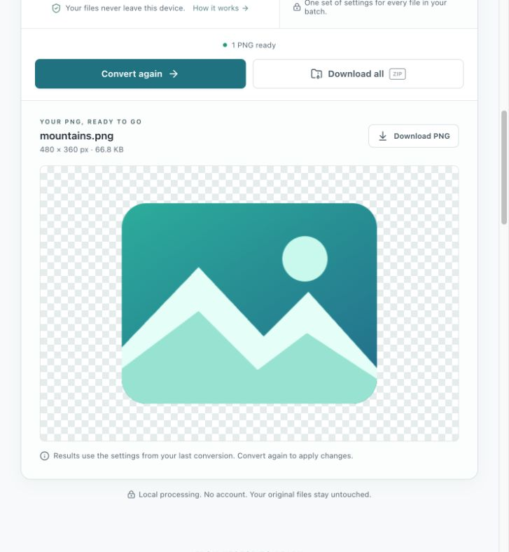

# Formatide — SVG to PNG Converter

Convert SVG files to PNG in your browser, with exact pixel dimensions, transparent backgrounds and batch ZIP downloads. Free to use. No account required.

**[Open Formatide](https://formatide.com/)** · [Conversion guide](docs/svg-to-png-guide.md) · [Sample SVGs](examples/) · [Report a problem](https://github.com/mcflysj/formatide-svg-to-png/issues/new/choose)

This is Formatide's public home for guides, examples and product feedback. The converter runs at **formatide.com**; this repository does not contain the application's source code.

## What you can do

- Convert one SVG or a batch of up to 50 files.
- Keep the original dimensions, use a 1×–4× scale, or choose a custom size.
- Fit artwork inside a fixed canvas without stretching or cropping it.
- Preserve transparency or fill the background with white or a custom color.
- Preview each result, download individual PNGs, or save completed files as a ZIP.
- Continue large batches in separate ZIP parts when the output memory limit is reached.

Your SVG files, image previews, PNGs and ZIPs are processed on your device. They are not uploaded to Formatide for conversion.

## Try it in three steps

1. Open **[formatide.com](https://formatide.com/)** and choose **Try a sample**, or select your own SVG files.
2. Choose the output size and background, then select **Convert to PNG**.
3. Check the preview and use **Download PNG** or **Download all ZIP**.

*A converted PNG preview. The checkerboard indicates transparency and is not part of the downloaded image.*

## Useful examples

| Task | Suggested settings |
| --- | --- |
| Export an app icon at twice its original size | **Scale → 2×**, transparent background |
| Put a logo on a presentation slide | Custom dimensions, transparent or white background |
| Give differently shaped images the same canvas size | **Custom → Fixed canvas**, set width and height |
| Convert several illustrations together | Select the files, convert, then download the ZIP |

The [conversion guide](docs/svg-to-png-guide.md) explains sizing, transparency, fonts and common errors. The [sample folder](examples/) contains three small SVGs with known dimensions so you can check the workflow before using your own artwork.

## Current limits

| Limit | Value |
| --- | --- |
| Files per batch | 50 |
| Input file size | 10 MiB per file; 50 MiB per batch |
| PNG dimensions | Up to 4,096 px per side and 16 megapixels |
| PNG results held at one time | 64 MiB |

At the output limit, Formatide pauses the batch. Download the completed part, confirm that you have saved it, then continue. Keep the tab open until you have downloaded everything. Clearing or refreshing the page ends the current session; there is no saved conversion history.

## Before you convert

**SVG support:** Formatide handles static SVG artwork. External images, fonts and stylesheets must be embedded. Scripts, animation and embedded HTML are not supported.

**Text:** Fonts must be available to the browser or embedded in the SVG. Convert text to outlines in your design tool when exact lettering matters. Always inspect the PNG preview.

**Transparency:** A transparent background preserves empty areas. It does not remove a white rectangle or another background already drawn inside the SVG.

**Offline use:** Conversion works locally after the page and conversion resources have loaded. ZIP packaging also needs its resource to have loaded. Opening the website or loading a new resource requires a connection.

## Privacy

File conversion stays in your browser. Website delivery still makes ordinary network requests. Optional usage analytics is off until you give consent; rejecting it does not limit conversion features. See the [privacy policy](https://formatide.com/privacy) for details and use **Privacy settings** in the website footer to change your choice.

## Feedback

[Open an issue](https://github.com/mcflysj/formatide-svg-to-png/issues/new/choose) for a reproducible problem or a feature suggestion. Include your browser, the settings used, and what happened. GitHub issues are public: use a small synthetic SVG if an example is needed, and remove private artwork or identifying information from screenshots.

For information about the hosted tool, see [About Formatide](https://formatide.com/about) and the [terms of use](https://formatide.com/terms).
