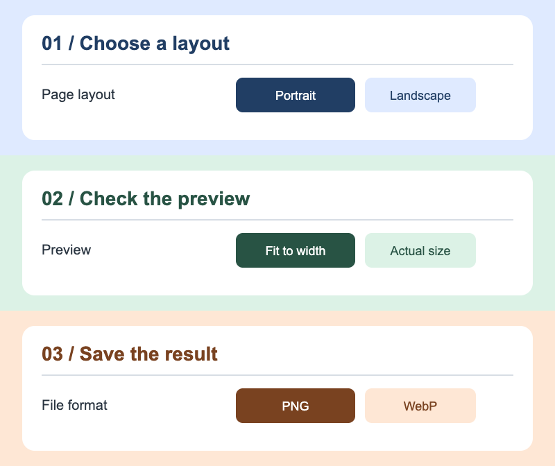

# Turn a few screenshots into one visual guide

A support article sometimes needs three small screenshots to explain one task. If the publishing tool gives you a single image slot, stack the screenshots in reading order and check that the labels still read clearly at the width readers will see.

The example below shows a fictional three-step export workflow. The source panels are 800 × 224 pixels each. They make one 800 × 672 PNG with the default stack settings.

## Try it with the sample panels

1. Download the [layout](exports/screenshot-stack/01-choose-layout.svg), [preview](exports/screenshot-stack/02-check-preview.svg) and [export](exports/screenshot-stack/03-save-export.svg) panels. The files are static SVGs made for this example. You can also use your own PNG screenshots.
2. Open Formatide and import the panels in numbered order. Click **Select all**, then choose **Stack** in the selection toolbar. [Open the image canvas](https://formatide.com/)
3. Check the top-to-bottom order on the canvas. With the three sample panels and the default settings, the width stays at 800 px and the heights add up to 672 px. Click **Merge & download** to save the PNG.
4. Insert the result at the width your article uses. If the controls are too small to read, crop the screenshots to the controls that matter before stacking. Put the steps in the article text too, so readers can follow them without the image.

I maintain Formatide and made the sample panels. I checked the downloaded PNG in Chrome and verified the blue, green and orange panels in order. [Download the tested PNG](exports/screenshot-stack/setup-guide.png)
